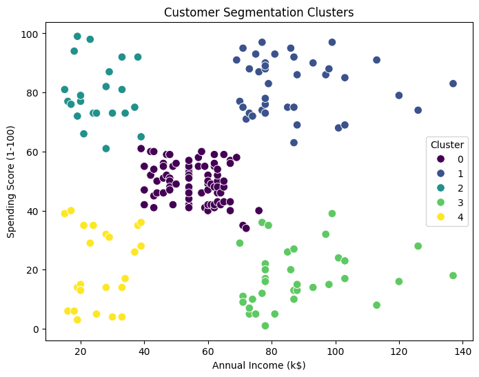

# Customer Segmentation with K-Means

Unsupervised segmentation of mall customers by Annual Income and Spending Score, using K-Means — with no target column and no labels telling the model the "right" groups.

## A note on the data

This notebook started life written for a different file (an online retail dataset with `Total Sales` / `Quantity` columns). The dataset actually available for this run is the classic Mall Customers dataset (`CustomerID`, `Gender`, `Age`, `Annual Income (k$)`, `Spending Score (1-100)`), so the notebook has been adapted to use Annual Income and Spending Score as the two clustering features — the standard pairing for this dataset. `Gender` and `Age` are read in but not used for clustering, so the result stays a clean, plottable 2D picture.

## What the notebook does, and why

The original version this builds on loaded data, dropped missing values unconditionally, scaled, ran the elbow method, and plotted the result. This version keeps that same shape but adds:
# Checks before actions confirms there's something to clean before cleaning it (this dataset, as it turns out, has no missing values or duplicates)
# Silhouette score, not just inertia — a clustering model isn't "done" once it runs, only once it's evaluated
# Cluster profiling and naming — turning cluster numbers into segments a retail team could act on

## Results from the included run

| | |
|---|---|
| Rows | 200, 0 missing, 0 duplicates |
| Features used | Annual Income (k$), Spending Score (1-100) — scaled with `StandardScaler` |
| k chosen | 5 — the elbow bends clearly at k=5 (inertia 109 → 66) and the silhouette score peaks there too (0.555), so unlike a lot of real data, there was no elbow-vs-business trade-off to make here |
| Final silhouette score | 0.555 — a strong, well-separated result |

The five segments found are the well-known pattern for this dataset:

| Cluster | Income | Spending | Segment |
|---|---|---|---|
| 0 | Average (~$55k) | Average (~50) | Average Income, Average Spending |
| 1 | High (~$87k) | High (~82) | High Income, High Spending (Target) |
| 2 | Low (~$26k) | High (~79) | Low Income, High Spending (Careless) |
| 3 | High (~$88k) | Low (~17) | High Income, Low Spending (Careful) |
| 4 | Low (~$26k) | Low (~21) | Low Income, Low Spending (Sensible) |

Note: cluster numbers (0–4) are assigned arbitrarily by the algorithm and can land differently on a different run or random_state. The notebook prints each cluster's profile right before applying the name mapping, specifically so you can confirm the numbers still line up before trusting the labels.



## Repo contents

```
Customer_Segmentation_K_Means.ipynb   the notebook, with outputs from a real run
Mall_Customers.csv                    the dataset
cluster_plot.png                      the final segmentation scatter plot
requirements.txt
```

## Running it

### VS Code

1. Install the Python and Jupyter extensions if you don't have them.
2. Clone the repo and open the folder in VS Code.
3. Create a virtual environment and install dependencies:
   ```bash
   python -m venv .venv
   source .venv/bin/activate        # Windows: .venv\Scripts\activate
   pip install -r requirements.txt
   ```
4. Open `Customer_Segmentation_K_Means.ipynb`, select the `.venv` interpreter as the kernel (top right), and Run All.

The notebook detects that it isn't running in Colab and automatically reads `Mall_Customers.csv` from the same folder — no path editing needed.

### Google Colab

1. Upload `Mall_Customers.csv` to `MyDrive/machine_learning/` in your Google Drive.
2. Upload the notebook to Colab (File → Upload notebook), or open it directly from GitHub (File → Open notebook → GitHub → paste the repo URL).
3. Runtime → Run all. It will prompt you to mount your Drive and then read the file from `MyDrive/machine_learning/Mall_Customers.csv` automatically.

The notebook detects the environment itself (Colab vs. local), so the same file runs correctly either way.

## Tools

Python, pandas, scikit-learn (`KMeans`, `StandardScaler`, `silhouette_score`), matplotlib, seaborn.
